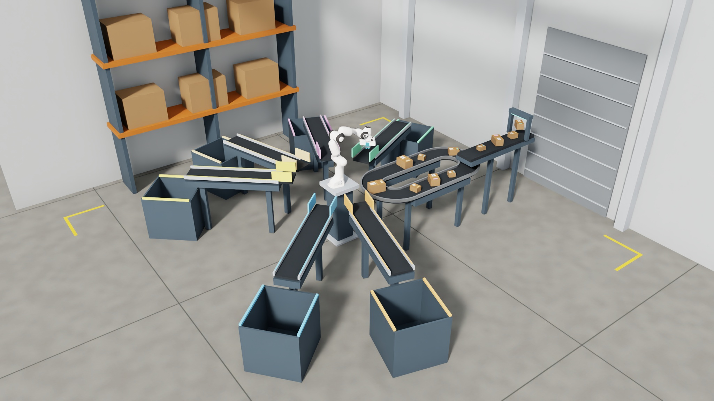

<!--
Copyright (c) 2022-2026, The Isaac Lab Project Developers (https://github.com/isaac-sim/IsaacLab/blob/main/CONTRIBUTORS.md).
All rights reserved.

SPDX-License-Identifier: BSD-3-Clause
-->

# Franka suction parcel sorting

`IsaacContrib-Conveyor-Suction-Sorting` demonstrates replicated force-based Newton suction
and shared success-guided reset sampling. Twelve differently sized parcels circulate through
a compact workcell with a gravity-drop feeder. A Franka places parcels at commanded positions
on five or six receiving belts, which deliver them into physical bins. The policy controls the arm
and vacuum; belts run continuously.



The tool has four visible suction cups of 12 mm radius on the existing Panda hand. Suction requires a nearby,
aligned parcel face and applies the upstream Newton prototype's compliant, capped forces.
It does not move parcels by writing their poses. The original fingers are visually hidden
and their collisions disabled. Existing finger-gripper policies require retraining.

## Experimental dependency

Newton's [surface-gripper prototype](https://github.com/newton-physics/newton/pull/3974)
is not merged. This branch pins an experimental public extraction of that implementation
and its matching MuJoCo dependencies in `pyproject.toml` and `uv.lock`; it does not vendor
the seal implementation into Isaac Lab. Stock Newton releases do not provide this API yet.

## Training and playback

The default configuration uses 512 environments, 6,000 PPO updates, and 30-second training episodes.
PPO collects 128 steps per environment per update with discount 0.999 and GAE lambda 0.99.
Training practices one assignment per episode: its first verified receipt ends the episode successfully,
and missing the assigned pickup fails the attempt. Playback uses the first randomized five-lane fixture and
240-second episodes, continuing to another parcel after each controlled placement. Each verified
delivery counts as a success. Evaluate checkpoints from full starts; curriculum success rates alone
do not establish end-to-end performance. Conveyors reach operating speed within one physics step
to match ongoing training resets.

```bash
uv run isaaclab train --task IsaacContrib-Conveyor-Suction-Sorting \
  --rl_library rsl_rl --num_envs 512 --device cuda:0

uv run isaaclab play --task IsaacContrib-Conveyor-Suction-Sorting \
  --rl_library rsl_rl --checkpoint /path/to/model.pt \
  --num_envs 1 --device cuda:0 --viz newton_gl --real-time
```

With Isaac Sim installed, use `--viz kit` for RTX visualization.

The policy outputs three Cartesian target increments and one binary vacuum command. Standard
differential IK maintains a downward tool orientation, with bounded target lead and normal
Franka joint velocity limits. The policy bounds Cartesian means to the accepted action range and
starts near rest with a 98% vacuum-hold exploration prior. Either vacuum command retains at least 0.1%
sampling probability during training. This floor is configured by
`agent.actor.distribution_cfg.tool_probability_floor` and saved in `params/agent.yaml`.
Keep the matching agent configuration with a checkpoint when resuming or replaying it.
Observations include the selected parcel's pose, velocity and
dimensions, robot and tool states, pickup and placement qualification, and the commanded
parcel-center goal in the robot frame. A small overhead ray scan observes collision geometry
as robot-frame points and hit-validity bits. Training adds 3 mm measurement noise and 2% ray dropout;
playback disables both. Coordinates use the fixed scan range, and joint velocities are scaled by 0.1.
The actor and critic do not use empirical observation normalization: a previously constant floor ray must
not amplify a newly observed obstacle through near-zero training variance.
The scan uses Newton physics rather than an RTX camera;
the 24 cm ray spacing can miss thin obstacles, and occluded surfaces are not observed.
Earlier checkpoints require retraining with
the new observations and controlled-placement objective.
Parcel dimensions vary across twelve fixed cuboid assets spanning five size classes.
Parcels are 8.5–19 cm long and weigh approximately 64–431 g. The receiving lanes have
24 cm openings to accommodate the largest packages. Earlier suction checkpoints require
their matching parcel catalogue and tool configuration; the observation shape alone does not imply compatibility.
Training distributes parallel environments across 32 coherent physical fixtures with five or six
receiving lanes on both sides of the robot. Lane angles, radial positions, and heights vary together
with the corresponding goal, bin, and reset geometry. Each environment keeps its fixture for its
lifetime; placement offsets, full-turn parcel yaw, and starting states vary at reset. Parcel mass varies
from 0.7 to 1.3 times nominal, friction from 0.4 to 0.9, and restitution from 0 to 0.05 through standard
startup event terms. Mass and inertia change together; these properties stay fixed within each world.
Training samples every active destination independently
of package dimensions, with placement offsets inside its supported receiving area. Playback routes each size class to its original
outlet. Both modes supply the goal explicitly, so dimensions cannot replace following the
command. Colors make the scene readable without becoming policy inputs. Goals are restricted
to these reachable, supported receiving areas; this example does not establish transfer to
arbitrary facilities or obstacles. The interface has 312 observations and four actions. The wider collision scan
changes the spatial meaning of its samples, so earlier checkpoints require their original observation configuration.
New training uses fresh weights; earlier checkpoints require their matching observation scaling and normalizer.
Evaluate separately on held-out fixture layouts before claiming generalization.

`make_logistics_layouts(seed=73, count=32)` fixes the training catalog. Use a separate seed with
`held_out=False` to test new combinations inside the training sectors, and
`make_logistics_layouts(seed=1701, count=8, held_out=True)` for a separate fixture catalog with two
outlets per fixture in reserved angular bands. Training outlet centers cover front angles
[-145, -105] and back angles [20, 140] degrees; the reserved bands are [-160, -153] and [151, 158].
Apply a catalog through `scene.outfeeds.spawn.assets_cfg` using `OutfeedsCfg(layout=layout)` before
launch. Evaluate the first original assignment from full-home starts and report reserved-outlet
deliveries separately from familiar outlets. New random seeds alone do not establish extrapolation.

## Reset distribution and success

The public `isaaclab_tasks.utils.ResetStateSampler` tracks 49 shared progress buckets:
sixteen points each for controlled descent, held lift/transport, and unheld approach, plus a full-home start.
Each draw independently chooses a parcel, destination, and pickup anchor on the world's physical fixture.
The default cached geometry contains 270,336 physical states, while the outcome history stays small enough to
receive repeated attempts. Layout and package variations share progress history instead of fragmenting it.
The Beta sampler favors intermediate success and retains a uniform strategy with weight 0.005.

Connected paths cover contact, lift, transport around the pedestal, and controlled descent.
Earlier approach states rewind the moving parcel around the incoming turn. Held starts restore native
suction seals against the reset geometry before the first observation. Other parcels are shuffled among
the remaining belt and feeder slots, preserving each slot's support height. The loop's pickup turn
stays clear, and neighboring slots accommodate every parcel orientation without overlap.
Initially, about 6% of sampled starts are already near enough to
practice a controlled release. These bootstrap states connect continuously to larger descents;
progress levels 9–15 retain at least 6 cm of geometric clearance above the receiving surface.
Released outfeed starts are excluded: the conveyor can complete those deliveries without a policy
action. No reset seeds a receipt or successful outcome.

No parcel starts with delivery credit in any reset phase. Release is checked before detachment:
the parcel must be upright, close to its commanded position, at most 2 cm above the receiving
surface, and moving slowly relative to either the stationary world or the moving belt.
Excessive vertical or angular velocity, an uncontrolled release, or nongripper arm contact fails
the attempt. Only a qualified placement followed by a settled receipt in the commanded bin
earns credit; a thrown parcel cannot qualify merely by landing in that bin.
A verified physical receipt earns a reward of +10. Training retains its original target until that
receipt or a failure; it cannot replace a missed parcel with an easier incoming one.
During continuing playback, a controlled release that has detached and cleared the suction pads
allows the dispatcher to select another parcel before the previous bin arrival. Released parcels retain
their own destinations and receipt checks while the arm handles the next target. Simultaneous receipts
each earn credit; a receipt never changes the current grasp. Playback also replaces missed pickups
with incoming targets. Each handoff rebases the Cartesian controller at the measured tool pose without moving the scene.
The original reset parcel's receipt immediately records a successful outcome for its
shared progress bucket. Other receipts still earn rewards and increment delivery counters, but are not
attributed to the earlier reset state. A world reset before the original parcel's receipt records a
failed row outcome; a later failure does not overwrite or duplicate an already recorded success.

The reward remains sparse: a complete qualified receipt earns +10; failures and motion
regularization retain their existing penalties. There are no reaching, lifting or goal-distance
rewards. Reset-family metrics separately expose placement, carry and acquisition.
`release_reset_success_rate` tracks the three easiest descent levels; `descent_success_rate`
tracks levels 9–15, which start at least 6 cm above the receiving surface. Release-ready bootstrap
success is separate from learning a substantial descent or a full pickup.
Training starts receive more practice when the policy has intermediate success, while
every progress bucket remains eligible. Sampling history is local to each worker and restarts
when the environment is recreated. Training success from an easier reset is not an
end-to-end pickup result. Evaluate separately from full belt starts and report correct-bin
deliveries by size class, wrong-bin deliveries, drops, and complete twelve-parcel batches.

Playback samples full belt starts uniformly. `full_start_success_rate` measures receipt of the
original assigned parcel from a full home start; `full_batch_success_rate` separately measures all
twelve physical receipts from that start. A single training delivery ends its episode successfully.
Playback replenishes the scene after all twelve parcels arrive; timeout or losing an unsorted parcel
also ends the episode.

Evaluate the retrained policy from full starts, with held-out reset seeds and destination
commands. Report controlled-placement success and arm contacts alongside physical receipts;
the earlier receipt-only policies are not evidence for this stricter objective.

## Sparse-event SuperMimic experiment

An optional single-GPU experiment uses the draft [Isaac Lab SuperMimic integration](https://github.com/isaac-sim/IsaacLab/pull/8867)
and its pinned [RSL-RL implementation](https://github.com/leggedrobotics/rsl_rl/pull/255).
It starts a new policy on the same native scene, reset sampler and sparse objective:
+10 for a verified controlled delivery, -1 for failure, and the existing motion penalties.

```bash
uv run isaaclab train --task IsaacContrib-Conveyor-Suction-Sorting \
  --rl_library rsl_rl --agent rsl_rl_supermimic_cfg_entry_point \
  presets=supermimic_state --num_envs 512 --device cuda:0
```

The learner fits observed state changes and two event heads from real simulator transitions.
Imagined rollouts optimize the predicted receipt and failure probabilities as a differentiable
surrogate for the native sparse events; they do not create environmental successes or add
reaching rewards. The commanded goal and parcel dimensions stay fixed during imagination.
The actor uses five observation frames and the explicit goal, with the same cloud noise and
fixed feature scales as the native policy. Discount 0.999 and TD(lambda) 0.99 match PPO.
Imagined rollouts span 32 policy steps (0.53 seconds); later bin receipts depend on learned
dynamics and bootstrapped values beyond that window. The modeled observation is partial: it does not
contain the complete scene or all randomized physical properties.

Sparse positive labels can be rare. Training logs therefore report the actual receipt-label
count and event-head predictions on real positive and negative transitions. These diagnostics
and model losses do not establish policy success. Evaluate first-assignment deliveries in native
physics from full-home starts, including independently reserved fixtures. The upstream learner
does not support distributed training; this experiment requires its matching agent configuration
and cannot load a PPO checkpoint.

## Facility references

The compact feeder, vacuum-pick cell and guarded receiving lanes follow ordinary parcel-hub organization,
including [BEUMER robotpick](https://www.beumergroup.com/products-systems/logistics-systems/beumer-robotpick/)
and [Vanderlande's infeed, sorters and chutes](https://www.vanderlande.com/parcel/systems/).
The scene uses native primitives with physical decks, guards and bins; decorative
supports remain visual only.

Support owner: Maximilian Krause. This example incubates the Newton suction integration;
the adapter should follow the public upstream API once it stabilizes, and the task can be
relocated if this capability is covered by a smaller maintained example.
